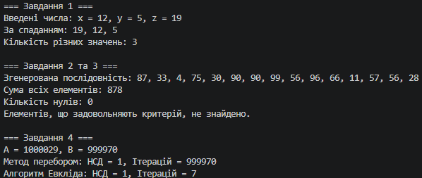

# Лабораторна робота №1. Алгоритми з розгалуженням і циклами

N = 29, K = 3, a = 2, b = 1, c = 4

## Опис завдань за варіантом

* **Завдання 1 (Розгалуження):** Вводяться три числа. Вивести їх за спаданням без масиву й без сортування — лише умовами. Додатково вивести, скільки серед них різних значень ($a = 2$).

* **Завдання 2 (Цикли та накопичення):**
  * *Джерело даних ($b = 1$):* 15 випадкових чисел у діапазоні $[1; 99]$ (використовується `new Random(29)`).
  * *Критерій відбору ($a = 2$):* Елементи, які непарні та менші за $K$ (тобто менші за 3).
  * *Результат ($c = 4$):* Найбільший серед таких елементів.
  * *Спільна частина:* Обчислити суму всіх елементів та кількість нулів за один прохід, без масивів.

* **Завдання 3 (Крайові випадки):** Перевірка алгоритму із завдання 2 на граничних умовах.

* **Завдання 4 (На «відмінно»):** Обчислення НСД для $A = 1\,000\,029$ та $B = 999\,970$ двома способами (перебір дільників та алгоритм Евкліда) з порівнянням кількості ітерацій.

## Завдання 3. Таблиця крайових випадків

| Вхідні дані | Що очікуємо | Що вивела програма |
| --- | --- | --- |
| **Порожній вхід** (жодного числа) | Сума: 0, нулів: 0, відсутність аварійного завершення (`Exception`), коректне повідомлення «Немає даних». | **Сума:** 0, **Нулів:** 0, **Результат:** Немає даних. *(Програма відпрацювала без помилок)*. |
| **Рівно одне число** (наприклад, `1`) | Обробити єдине число, порахувати суму та перевірити критерій відбору. | **Сума:** 1, **Нулів:** 0, **Результат:** 1. |
| **Усі числа однакові** (наприклад, `1, 1, 1, 1`) | Правильне накопичення суми, відсутність зациклення або збоїв. | **Сума:** 4, **Нулів:** 0, **Результат:** 1. |
| **Жоден елемент не відповідає критерію** (наприклад, `4, 6, 8, 10`) | Сума та нулі обчислюються, але замість виведення помилкового «0» програма повідомляє про відсутність потрібних елементів. | **Сума:** 28, **Нулів:** 0, **Результат:** Немає даних. |

### Виправлена помилка

При ініціалізації змінної пошуку максимуму значенням `0` (`int max = 0`) програма виводила б `0` на порожньому вході або коли жоден елемент не відповідав критерію (оскільки всі числа додатні).

**Виправлення:** Впроваджено прапорець `bool hasSelected = false`, який гарантує відстеження наявності хоча б одного елемента, що задовольняє умову, уникнувши хибного виведення нульового значення.

## Завдання 4. Порівняння алгоритмів НСД

* **Числа:** $A = 1\,000\,029$, $B = 999\,970$
* **Спосіб 1 (Перебір дільників):** НСД = 59, кількість ітерацій = 999 912
* **Спосіб 2 (Алгоритм Евкліда):** НСД = 59, кількість ітерацій = 7

### Висновок до завдання 4

Кількість ітерацій відрізняється у 142 844,6 разів (алгоритм Евкліда виконує всього 7 кроків завдяки залишку від ділення, тоді як перебір робить майже мільйон перевірок), проте результат НСД залишається абсолютно однаковим.

